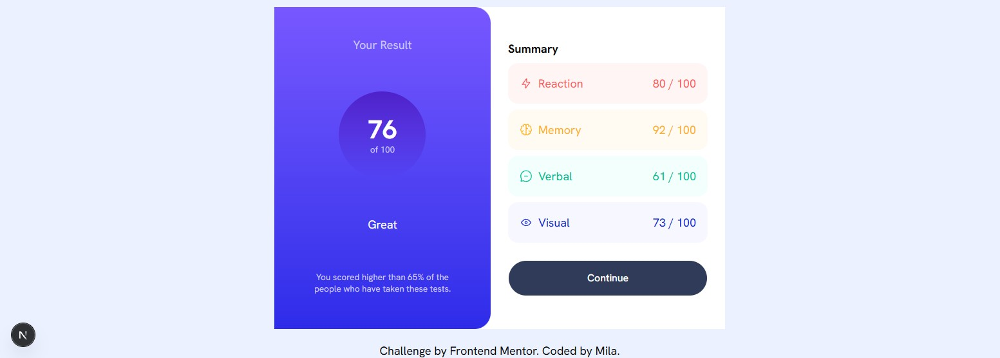

# Frontend Mentor - Results summary component solution

This is a solution to the [Results summary component challenge on Frontend Mentor](https://www.frontendmentor.io/challenges/results-summary-component-CE_K6s0maV). Frontend Mentor challenges help you improve your coding skills by building realistic projects.

## Table of contents

- [Overview](#overview)
  - [The challenge](#the-challenge)
  - [Screenshot](#screenshot)
  - [Links](#links)
- [My process](#my-process)
  - [Built with](#built-with)
  - [What I learned](#what-i-learned)
  - [Continued development](#continued-development)
  - [Useful resources](#useful-resources)
  - [AI Collaboration](#ai-collaboration)
- [Author](#author)

## Overview

### The challenge

Users should be able to:

- View the optimal layout for the interface depending on their device's screen size
- See hover and focus states for all interactive elements on the page
- **Bonus**: Use the local JSON data to dynamically populate the content

### Screenshot

### Links

- Solution URL: [Github code](https://github.com/farazpc3/results-summary-component-main-frontend-mentor)
- Live Site URL: [Vercel Deployment](https://results-summary-component-main-fron-nine.vercel.app/)

## My process

### Built with

- Semantic HTML5 markup
- CSS custom properties
- Flexbox
- Mobile-first workflow
- CSS Tailwind
- Typescript
- [React](https://reactjs.org/) - JS library
- [Next.js](https://nextjs.org/) - React framework
- [Shadcn](https://ui.shadcn.com) - For template components
- [Postgresql](https://www.postgresql.org) - Database
- [Prisma](https://www.prisma.io) - Database connection

### What I learned

It's better to create initiate a project along with the database instead of adding it later.
The tailwind solves responsiveness much more.
I'll need much larger project to properly practice this stack on

### Continued development

I will start a personal project to better practice this stack

### Useful resources

- [Next.js](https://nextjs.org/) - Next.js documentation.
- [Tailwind](https://tailwindcss.com/) - Tailwind documentation.
- [Prisma](https://www.prisma.io) - Prisma documentation.

### AI Collaboration

As usual due to regional restrictions on Iran, I've used deepseek. hopefully will use the AI properly in the future.

## Author

- Website - [Mila](https://farazcv.vercel.app)
- Frontend Mentor - [@farazpc3](https://www.frontendmentor.io/profile/farazpc3)
